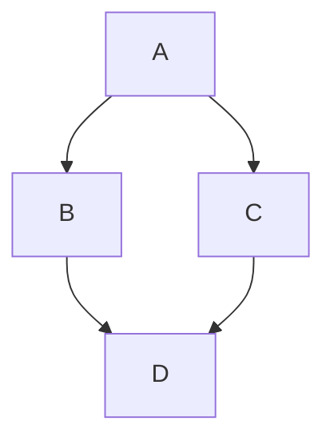

# mWarsztat
Two-module IT system for car workshop management

Documentation: https://www.overleaf.com/project/6adfa7efc39fa7d2add442c5/share#8d0987fc4d474be2db260f3539df2c1736f581a73e1b4cea

Here is a simple flow chart:

