# mWarsztat
Two-module IT system for car workshop management

Documentation: https://www.overleaf.com/project/6adfa7efc39fa7d2add442c5/share#8d0987fc4d474be2db260f3539df2c1736f581a73e1b4cea

## Wykres Gantta

## Roadmapa

```mermaid
flowchart LR
    I85["#85 Skonfigurowanie narzędzia do tworzenia wykresu Gantta"]
    I83["#83 Mapa pojeć"]
    I82["#82 Wprowadzenie ewentualnych poprawek"]
    I81["#81 Przeprowadzenie testów i wyciągnięcie wniosków"]
    I80["#80 Przygotowanie materiałów testowych"]
    I79["#79 Znalezienie 10 testerów interfejsu"]
    I78["#78 Testy interfejsu użytkownika"]
    I77["#77 Podsumowanie projektu"]
    I76["#76 Analiza ryzyka"]
    I75["#75 Zaprojektowanie interfejsu użytkownika"]
    I74["#74 Koncepcja bazy danych i wybór środowiska"]
    I73["#73 Zaprojektowanie bazy danych"]
    I72["#72 Zaprojektowanie architektury systemu"]
    I71["#71 Modelowanie UML"]
    I70["#70 Modelowanie procesów biznesowych"]
    I69["#69 Analiza wymagań"]
    I68["#68 Analiza problemu"]
    I67["#67 Analiza interesariuszy"]
    I66["#66 Analiza projektu"]
    I65["#65 Harmonogram realizacji dokumentacji projektowej"]
    I64["#64 Końcowa prezentacja dokumentacji"]
    I63["#63 Lista funkcjonalności do implementacji"]
    I62["#62 Podsumowanie osiągnietych rezulatatów"]
    I61["#61 Karta projektu"]
    I59["#59 Opisanie reakcji na każde ryzyko"]
    I58["#58 Określenie wpływu poszczególnego ryzyka"]
    I57["#57 Określenie prawdopodobieństwa wystąpienia każdego ryzyka"]
    I56["#56 Opis każdego ryzyka"]
    I55["#55 Opis ekranów"]
    I54["#54 Makiety ekranów"]
    I53["#53 Diagram nawigacji"]
    I52["#52 Persony użytkowników"]
    I51["#51 Role użytkowników"]
    I49["#49 Reguły bezpieczeństwa i spójność"]
    I48["#48 Struktura dokumentów i typy danych Firestore"]
    I47["#47 Opis powiązań danych"]
    I46["#46 Diagram hierarchii kolekcji"]
    I45["#45 Architektura kolekcji i dokumentów"]
    I44["#44 Technologie systemu"]
    I43["#43 Moduły systemu"]
    I42["#42 Architekura logiczna systemu"]
    I41["#41 Diagram wdrożenia"]
    I40["#40 Diagram komponentów"]
    I39["#39 Diagram stanów"]
    I38["#38 Diagram aktywności"]
    I37["#37 Diagramy sekwencji"]
    I36["#36 Diagram klas"]
    I35["#35 Diagram przypadków użycia, szczegółowe opisy przypadków użycia"]
    I34["#34 Priorytety wymagań (MoSCoW)"]
    I33["#33 Wymagania użytkowników - mapa pojęciowa"]
    I32["#32 Wymagania biznesowe"]
    I31["#31 Opis stanu docelowego"]
    I30["#30 Analiza SWOT"]
    I29["#29 Analiza przyczyn problemów"]
    I28["#28 Identyfikacja problemów - mapa pojęciowa"]
    I27["#27 Analiza stanu obecnego"]
    I26["#26 Priorytyzacja interesariuszy ze względu na powodzenie projekty"]
    I25["#25 Strategia komunikacji z interesariuszem"]
    I24["#24 Potencjalne korzyści i zagrożenia dla interesariuszy"]
    I23["#23 Analiza zainteresowania projektem"]
    I22["#22 Analiza wpływy na projekt"]
    I21["#21 Potrzeby, oczekiwania i wymagania interesariuszy"]
    I20["#20 Identyfikacja i charakterystyka interesariuszy"]
    I19["#19 Cel analizy interesariuszy"]
    I18["#18 Matryca odpowiedzialności"]
    I17["#17 Utworzenie diagramu Gantta"]
    I16["#16 Stworzenie zadań (WBS)"]
    I14["#14 Role w projekcie"]
    I13["#13 Kryteria sukcesu"]
    I12["#12 Produkty projektu"]
    I11["#11 Zakres organizacyjny projektu"]
    I10["#10 Zakres niefunkcjonalny"]
    I9["#9 Zakres funkcjonalny projektu"]
    I8["#8 Cel główny projektu"]
    I7["#7 Problem projektowy"]
    I6["#6 Uzasadnienie projektu"]
    I5["#5 Informacje podstawowe projektu"]
    I3["#3 Etap 3"]
    I2["#2 Etap 2"]
    I1["#1 Etap 1"]
    I78 --> I77
    I76 --> I77
    I71 --> I75
    I71 --> I73
    I71 --> I72
    I65 --> I66
    I83 --> I66
    I61 --> I65
    I5 --> I7
    classDef done fill:#d4edda,stroke:#28a745,color:#000
    class I85,I61,I17,I16,I14,I13,I12,I11,I10,I9,I8,I7,I6,I5 done
```

<!-- ROADMAP:START -->

<!-- ROADMAP:END -->
